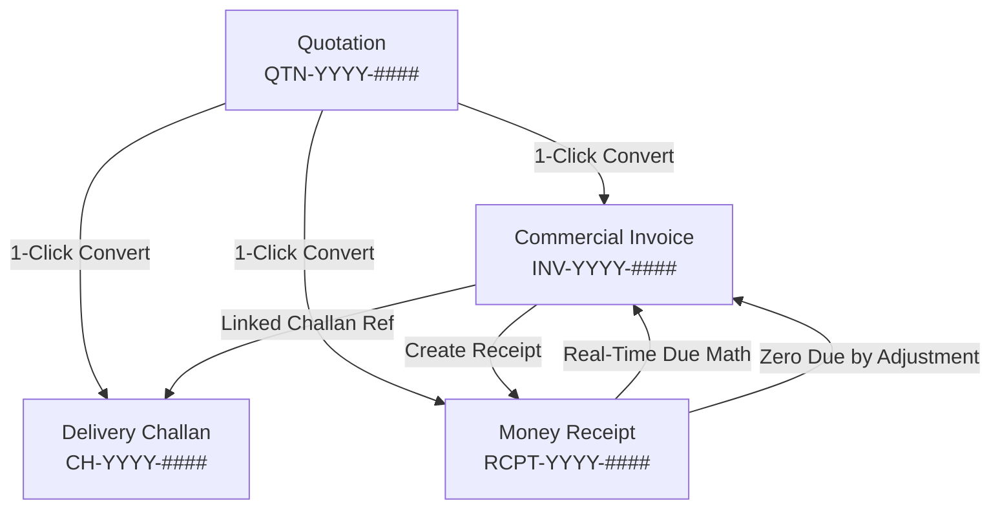

# AutoInvoice Developer & Architecture Guide

This guide provides technical reference documentation for developers, maintainers, and integrators working on the **AutoInvoice** platform.

---

## 🏛️ 1. Architecture Overview

AutoInvoice is designed as a **zero-dependency, offline-first, client-side web application**. It runs natively in any standard modern web browser with no compiler, bundler, server runtime, or external database required.

### Key Architectural Tenets
1. **Zero External Dependencies**: Uses native ECMAScript standard libraries and browser APIs (LocalStorage, Fetch, DOM, Canvas/SVG). Bootstrap 5 and QRCode.js are vendor-vendored locally in `assets/vendor/` and `js/vendor/`.
2. **Single Source of Truth for Data**: `localStorage` acts as the primary data store. A secondary read-only layer discovers pre-seeded JSON records from disk (`records/`) via `js/records.js`.
3. **Data Loss Immunity**: Changes are tracked with `isDirty` flags and protected by `beforeunload` events. Number sequences never skip if a form is abandoned.
4. **Financial Arithmetic Determinism**: Floating-point drift is strictly mitigated using two-decimal rounding functions (`roundBDT`) before every accumulation or persistence action.
5. **A4 Print Engine**: Dedicated `@media print` CSS calibrated for physical paper with quiet zones and page-break isolation.

---

## 🔄 2. Document Lifecycles & State Transitions

AutoInvoice facilitates a seamless commercial pipeline from pre-sales proposal through delivery and final receivables clearance.



### Lifecycle Workflows
- **Quotation Flow**:
  1. User fills client and item proposals.
  2. Clicking **Convert to Invoice** saves the quotation, allocates a peeked invoice number, copies items, and passes the reference as `[Quotation: QTN-YYYY-####]`.
  3. Clicking **Convert to Challan** strips pricing and populates quantities into a new delivery note.
- **Invoice & Receivables Flow**:
  1. On load, `peekNextInvoiceNumber()` previews the next monotonic sequence number without advancing the counter.
  2. The invoice automatically calculates its due date (15 working days forward, skipping Fridays and Saturdays in Bangladesh).
  3. Upon clicking **Save Invoice**, `finalizeInvoiceNumber()` permanently records the high-water mark counter, stores the invoice, and auto-saves the client contact profile.
- **Money Receipt Flow**:
  1. Linked to an existing invoice via `#linkedInvoice`.
  2. `getInvoicePaymentStats(invNo)` queries all historical receipts for that invoice, calculates cumulative payments, and derives real-time outstanding due.
  3. If payment amount matches or user activates **Zero Due by Adjustment**, any remaining residual balance is settled with an explicit audit trail logged on the invoice record.

---

## 🔢 3. Monotonic Numbering & Sequence Architecture

To comply with accounting and tax audit requirements, document numbers must not contain gaps caused by discarded drafts or refreshed pages.

### Peek vs. Finalize Pattern
Instead of incrementing the counter when a page is opened, AutoInvoice splits sequencing into two phases:
- `peekNext<Type>Number()`: Calculates `last.seq + 1` and formats the string (e.g., `INV-2026-0005`) for display in read-only input fields. Does **not** modify `localStorage`.
- `finalize<Type>Number(number)`: Executed solely inside the save handler:
  ```javascript
  function finalizeInvoiceNumber(no) {
    if (!no) return;
    const parts = String(no).split('-');
    const year = Number(parts[1]) || new Date().getFullYear();
    const seq = Number(parts[2]) || 0;
    if (!seq) return;
    let last = _readJSON(STORAGE_KEYS.lastInvoiceNo, { year, seq: 0 });
    // High-water mark protection: never decrement if saving an older/historical document
    if (last.year === year && seq <= last.seq) return;
    _writeJSON(STORAGE_KEYS.lastInvoiceNo, { year, seq });
  }
  ```

### Number Formatting
Defined in [js/constants.js](file:///e:/AutoInvoice/js/constants.js):
- **Invoice**: `INV-YYYY-####` (e.g., `INV-2026-0001`)
- **Challan**: `CH-YYYY-####` (e.g., `CH-2026-0001`)
- **Quotation**: `QTN-YYYY-####` (e.g., `QTN-2026-0001`)
- **Receipt**: `RCPT-YYYY-####` (e.g., `RCPT-2026-0001`)

---

## 💾 4. Data Models & JSON Schemas

All entities stored in `localStorage` or exported as backups adhere to the following schemas.

### 4.1 Commercial Invoice Schema
```typescript
interface InvoiceRecord {
  invoiceNumber: string;         // e.g. "INV-2026-0001"
  date: string;                  // "YYYY-MM-DD"
  title: string;                 // Project / Service name
  paymentMethod: "Cash" | "Bank Transfer" | "Cheque" | "Mobile Banking" | "Other";
  dueDate: string;               // "YYYY-MM-DD" (defaults to 15 working days forward)
  linkedChallan?: string;        // Optional delivery note reference
  client: {
    name: string;
    address: string;
    title?: string;
    company?: string;
  };
  items: Array<{
    name: string;                // Item name
    desc: string;                // Technical description
    qty: number;                 // Numeric quantity
    unitPrice: number;           // Unit price in BDT
    lineTotal: number;           // roundBDT(qty * unitPrice)
  }>;
  grandTotal: number;            // roundBDT(sum(lineTotal))
  amountInWords: string;         // e.g. "One Lakh Fifty Thousand Taka Only"
  qrData: string;                // Standardized QR payload string
  savedAt: string;               // ISO 8601 string
}
```

### 4.2 Delivery Challan Schema
```typescript
interface ChallanRecord {
  challanNumber: string;         // e.g. "CH-2026-0001"
  numberMode: "auto" | "manual"; // Sequencing mode
  date: string;                  // "YYYY-MM-DD"
  title: string;                 // Project title
  client: {
    name: string;
    company?: string;
  };
  deliveryAddress: string;       // Destination shipping address
  items: Array<{
    name: string;                // Item name
    desc: string;                // Specification / serial number
    qty: number;                 // Shipped quantity
    unit?: string;               // "Pcs" | "Kg" | "Set" | "Box" | etc.
  }>;
  qrData: string;                // Standardized QR payload
  savedAt: string;               // ISO 8601 string
}
```

### 4.3 Quotation Schema
```typescript
interface QuotationRecord {
  quotationNumber: string;       // e.g. "QTN-2026-0001"
  date: string;                  // "YYYY-MM-DD"
  subject: string;               // Quotation subject header
  client: {
    name: string;
    title: string;
    company: string;
    address: string;
  };
  introText: string;             // Proposal preamble text
  items: Array<{
    desc: string;                // Item description
    qty: number;
    unitPrice: number;
    total: number;
  }>;
  grandTotal: number;
  amountInWords: string;
  scopeOfWork: string[];         // Itemized bullet list of deliverables
  specialNote?: string;          // Footnote or specific clause
  terms: string[];               // Terms and conditions list
  validityDays: number;          // Default: 30
  qrData: string;
  savedAt: string;
}
```

### 4.4 Money Receipt Schema
```typescript
interface ReceiptRecord {
  receiptNumber: string;         // e.g. "RCPT-2026-0001"
  date: string;                  // "YYYY-MM-DD"
  invoiceNumber: string;         // Linked invoice number
  client: {
    name: string;
    address: string;
  };
  paymentMethod: "Cash" | "Bank Transfer" | "Cheque" | "Mobile Banking" | "Other";
  amount: number;                // Amount received in BDT
  dueAmount: number;             // Remaining due balance after this receipt
  amountInWords: string;         // Words representation
  adjustment?: {
    applied: boolean;            // true if "Zero Due by Adjustment" was checked
    amount: number;              // Discount / write-down value
    originalTotal: number;       // Prior invoice total
    adjustedTotal: number;       // New total after adjustment
    timestamp: string;           // ISO 8601 timestamp
    method: "toggle";
  };
  qrData: string;
  savedAt: string;
}
```

### 4.5 Full Backup Archive Schema
```typescript
interface BackupArchive {
  version: 1;
  exportedAt: string;            // ISO 8601 timestamp
  invoices: InvoiceRecord[];
  challans: ChallanRecord[];
  receipts: ReceiptRecord[];
  quotations: QuotationRecord[];
  clients: ClientRecord[];
  lastInvoiceNo: { year: number; seq: number };
  lastChallanNo: { year: number; seq: number };
  lastReceiptNo: { year: number; seq: number };
  lastQuotationNo: { year: number; seq: number };
}
```

---

## 🧮 5. Financial Math & Precision Standards

JavaScript floating-point arithmetic can introduce rounding errors (e.g. `0.1 + 0.2 = 0.30000000000000004`). AutoInvoice guarantees financial precision through strict rules:

1. **Mandatory `roundBDT(val)`**: Every multiplication, addition, and percentage deduction must pass through `roundBDT()`:
   ```javascript
   function roundBDT(n) {
     return Math.round((Number(n) || 0) * 100) / 100;
   }
   ```
2. **South Asian Number Formatting (`formatBDT`)**: Formats numbers using the `en-IN` locale for authentic Bangladeshi Lakh (`1,00,000`) and Crore (`1,00,00,000`) grouping:
   ```javascript
   function formatBDT(amount) {
     const num = Number(amount || 0);
     return `৳${num.toLocaleString('en-IN', { minimumFractionDigits: 2, maximumFractionDigits: 2 })}`;
   }
   ```
3. **Number to Words Conversion (`numberToWordsBDT`)**: Decomposes numbers into Crores, Lakhs, Thousands, Hundreds, and Paisa:
   - Example: `1502500.50` &rarr; `"Fifteen Lakh Two Thousand Five Hundred Taka and Fifty Paisa Only"`.
   - Handles negative balances, zeroes, and boundary conditions (>100 Crores).

---

## 📱 6. Standardized QR Code Verification Engine

All documents render an SVG-based QR code for field scanning and document verification.

### Payload Schema
```text
DOC=<TYPE>|TXID=<Number>|DT=<Date>|AMT=<Amount>|CCY=BDT|BEN=<Company>|REC=<Client>|V=1
```

### Parameter Reference
| Parameter | Type | Description | Included In |
| :--- | :--- | :--- | :--- |
| `DOC` | String | Document identifier (`INV`, `CHAL`, `QTN`, `RCPT`) | All |
| `TXID` | String | Primary document number | All |
| `DT` | String | Issue date (`YYYY-MM-DD`) | All |
| `AMT` | Number | Document monetary value (2 decimal places) | Invoices, Quotations, Receipts |
| `CCY` | String | Currency code (`BDT`) | Invoices, Quotations, Receipts |
| `BEN` | String | Beneficiary / issuing company name (`Amirul Islam`) | All |
| `REC` | String | Client or recipient entity name | All |
| `V` | Integer | Specification version (`1`) | All |

*Note: Delivery Challans explicitly omit `AMT` and `CCY` to preserve pricing confidentiality for delivery personnel.*

---

## 🌐 7. URL Query Parameter Protocol

Pages communicate through structured query parameters, enabling deep-linking and cross-document navigation:

| Page | Parameter | Example | Behavior |
| :--- | :--- | :--- | :--- |
| `invoice.html` | `?no=` | `invoice.html?no=INV-2026-0001` | Loads existing invoice for viewing or editing. |
| `invoice.html` | `?convertFrom=qtn&no=` | `invoice.html?convertFrom=qtn&no=QTN-2026-0003` | Imports quotation data into a new draft invoice. |
| `challan.html` | `?no=` | `challan.html?no=CH-2026-0002` | Loads existing delivery challan. |
| `challan.html` | `?convertFrom=qtn&no=` | `challan.html?convertFrom=qtn&no=QTN-2026-0003` | Imports quotation items into a new delivery challan. |
| `quotation.html` | `?no=` | `quotation.html?no=QTN-2026-0001` | Loads existing quotation. |
| `receipt.html` | `?inv=` | `receipt.html?inv=INV-2026-0001` | Pre-fills receipt for linked invoice with calculated pending due. |
| `receipt.html` | `?no=` | `receipt.html?no=RCPT-2026-0001` | Loads existing money receipt for editing. |
| `receipt.html` | `?qa=1` | `receipt.html?qa=1` | Enables QA outline diagnostics around the QR container. |

---

## 🖨️ 8. Print CSS & Physical Layout Architecture

The print stylesheet ([css/print.css](file:///e:/AutoInvoice/css/print.css)) formats documents for physical A4 printing and PDF generation:

1. **Target Dimensions**:
   ```css
   @page {
     size: A4;
     margin: 18mm;
   }
   ```
2. **Control Elimination**: Navbars, theme switches, buttons, modals, and toasts are removed via `display: none !important;`.
3. **Form Flattening**: `input`, `textarea`, and `select` elements lose borders, backgrounds, and drop-shadows to print as clean typography.
4. **Physical QR Quiet Zones**:
   - The `#receiptQR` and `#qrContainer` containers are styled with a minimum physical dimension of `20mm × 20mm`.
   - A `2mm` white quiet-zone padding is applied to prevent edge clipping during printer feeding.
5. **Page Break Discipline**:
   - Headers and totals enforce `page-break-inside: avoid;`.
   - Table rows retain explicit heights to prevent split lines.

---

## 🔒 9. Security & Data Integrity

- **XSS Prevention**: User inputs are escaped using `escapeHTML()` before being inserted into any dynamic HTML templates.
- **Input Bounding**: `sanitizeRecord()` caps string lengths at 10,000 characters and filters non-finite numbers before persisting to `localStorage`.
- **Path Traversal Protection (`server.js`)**: The Node.js static server inspects resolved file paths against `__dirname` to prevent directory traversal attacks:
  ```javascript
  if (!filePath.startsWith(__dirname)) {
    res.writeHead(403);
    res.end('Forbidden');
    return;
  }
  ```

---

## 🧪 10. Test Suite Architecture

Unit tests run natively inside the browser via [tests/tests.html](file:///e:/AutoInvoice/tests/tests.html).

### Storage Isolation Sandbox
The test runner ([js/tests/test-runner.js](file:///e:/AutoInvoice/js/tests/test-runner.js)) captures a full snapshot of `localStorage` before every test execution and restores it immediately in the `finally` block:
```javascript
async function runTests() {
  const snapshot = backupStorage();
  for (const t of TESTS) {
    try {
      await t.fn();
    } finally {
      restoreStorage(snapshot);
    }
  }
}
```

### Writing a New Test
Add a test case in the appropriate file under `js/tests/`:
```javascript
test('My custom test feature description', () => {
  const conditionA = 1 + 1 === 2;
  const t1 = ok(conditionA, 'Arithmetic works');
  return [t1];
});
```
To run tests, execute `node server.js` and load [http://localhost:8080/tests/tests.html](http://localhost:8080/tests/tests.html).
